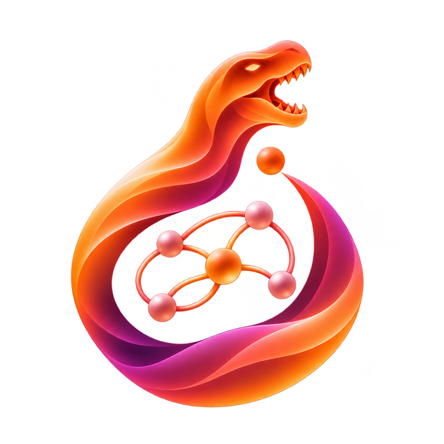

<p align="center">

<br>

</p>

<p align="center">


<a href="https://github.com/pre-commit/pre-commit"></a>
<a href="https://codecov.io/github/vdecaro/torchdyno"></a>
<a href="https://results.pre-commit.ci/latest/github/vdecaro/torchdyno/main"></a>
</p>

**TorchDyno** is a PyTorch library for building models of temporal data from interchangeable parts, and training them with or without backpropagation. Reservoirs, state space models, oscillator and continuous-time networks, and random convolutions are all plain `nn.Sequential` compositions. Fit them with ridge regression, recursive least squares, FORCE, intrinsic plasticity or gradient descent.

TorchDyno is designed for researchers and practitioners studying unconventional recurrent models and learning rules.

## Key features

- **Compose models:** a model is an `nn.Sequential` of parts from [four levels](https://torchdyno.readthedocs.io/en/latest/source/overview/concepts/index.html): weight matrices, sequence processing, readout and objectives. Each part is replaceable on its own.
- **Structure the weights:** use dense, diagonal, block-diagonal and skew-symmetric [matrices](https://torchdyno.readthedocs.io/en/latest/source/overview/concepts/matrices.html), each with its own initialisers and spectral scaling. `nn.Linear` works anywhere a matrix is expected.
- **Process sequences:** run any [recurrent cell](https://torchdyno.readthedocs.io/en/latest/source/overview/concepts/sequence.html) step by step or with a parallel scan, use ROCKET and MiniRocket kernels, and combine layers in series, side by side, residually, reversed or in a closed loop.
- **Fit without gradients:** use closed-form and online [learners](https://torchdyno.readthedocs.io/en/latest/source/overview/concepts/learners.html), alone or chained, next to backprop.
- **Handle real data:** feed [sequences of different lengths](https://torchdyno.readthedocs.io/en/latest/source/overview/advanced/variable-length.html) in one batch, and run [benchmarks](https://torchdyno.readthedocs.io/en/latest/source/overview/advanced/benchmarks.html) across seeds on NARMA, Mackey-Glass, Lorenz, memory capacity and UCR/UEA data.

## Fitted and trained

**Fitted readouts** freeze the dynamics and fit only the readout:
- in closed form, with ridge regression;
- online, with recursive least squares or FORCE.

Intrinsic plasticity can adapt a reservoir first, without gradients. Nothing is backpropagated through time, so a fit takes seconds.

**End-to-end training** trains every parameter that requires a gradient. Freeze any part with `requires_grad_(False)` to train the rest around it. The [benchmark guide](https://torchdyno.readthedocs.io/en/latest/source/overview/getting-started/benchmark-across-seeds.html) compares the two on the same model and seeds.

## Installation

TorchDyno is available on [PyPI](https://pypi.org/project/torchdyno/) and requires **Python `>=3.11,<3.15`**. Install it with pip:

```bash
pip install torchdyno
```

Or add it to a uv project:

```bash
uv add torchdyno
```

PyTorch is installed with it. See the [installation guide](https://torchdyno.readthedocs.io/en/latest/source/overview/install.html) to choose a CPU or CUDA build, and for development setup.

## Quickstart

Save this as `quickstart.py`. It builds an echo state network, a frozen random reservoir with a linear readout, and forecasts the Lorenz system one step ahead. Ridge regression fits the readout, keeping the penalty that scores best on the validation split.

```python
from torch import nn

from torchdyno import seed_all
from torchdyno.benchmark import lorenz_benchmark
from torchdyno.learners import Ridge, evaluate
from torchdyno.matrices import Dense, spectral, uniform
from torchdyno.sequence import LeakyCell, Recurrent

seed_all(0)
data = lorenz_benchmark(length=2000, target_delay=1, washout=100)

reservoir = Recurrent(
    LeakyCell(
        input=Dense(3, 300, init=uniform(1.0)),
        recurrent=Dense(300, 300, init=spectral(uniform(1.0), 0.9)),
        leak=0.5,
    )
).requires_grad_(False)
esn = nn.Sequential(reservoir, nn.Linear(300, 3))

result = Ridge(
    l2=[1e-8, 1e-6, 1e-4],
    washout=data.washout,
    score_fn=data.task.primary,
).fit(esn, data.train_loader, data.val_loader)
print("chosen l2:", result.best)

nrmse = evaluate(esn, data.eval_loader, data.task.primary, washout=data.washout)
print(f"test NRMSE: {nrmse:.2e}")
```

The `Dense` matrices take their initialisers: `spectral` rescales the recurrent matrix to a spectral radius of 0.9. `Recurrent` runs the leaky cell over time, and the washout leaves out the first 100 steps, while the reservoir forgets its initial state.

Run it:

```bash
python quickstart.py
```

It prints the chosen penalty with its validation score, then the test error:

```text
chosen l2: {'l2': 1e-08, 'score': 0.0002468338643666357}
test NRMSE: 4.89e-06
```

The last digits can differ across machines and PyTorch versions.

To adapt this experiment, swap any part on its own:
- a ring reservoir with `init=cycle(0.9)`;
- three reservoirs in a `Stack`;
- `IntrinsicPlasticity` chained before the ridge readout.

Continue with [reading out a reservoir](https://torchdyno.readthedocs.io/en/latest/source/overview/getting-started/first-reservoir.html) and [training a model end to end](https://torchdyno.readthedocs.io/en/latest/source/overview/getting-started/train-end-to-end.html).

## Examples

Each example composes a well-known model from TorchDyno's parts, fits it and prints its score, in seconds:

- **Reservoirs:**
  - [echo state network](https://torchdyno.readthedocs.io/en/latest/source/overview/examples/esn.html);
  - [deep echo state network](https://torchdyno.readthedocs.io/en/latest/source/overview/examples/deep_esn.html);
  - [intrinsic plasticity](https://torchdyno.readthedocs.io/en/latest/source/overview/examples/esn_plasticity.html).
- **Online learning:**
  - [recursive least squares in closed loop](https://torchdyno.readthedocs.io/en/latest/source/overview/examples/rls_forcing.html);
  - [FORCE](https://torchdyno.readthedocs.io/en/latest/source/overview/examples/force.html).
- **Trained recurrent models:**
  - [AdaDiag](https://torchdyno.readthedocs.io/en/latest/source/overview/examples/adadiag.html);
  - [SCN](https://torchdyno.readthedocs.io/en/latest/source/overview/examples/scn.html);
  - [coRNN](https://torchdyno.readthedocs.io/en/latest/source/overview/examples/cornn.html);
  - [CfC](https://torchdyno.readthedocs.io/en/latest/source/overview/examples/cfc.html).
- **State space models:**
  - [LRU](https://torchdyno.readthedocs.io/en/latest/source/overview/examples/lru.html);
  - [S4D](https://torchdyno.readthedocs.io/en/latest/source/overview/examples/s4d.html).
- **Random convolutions:**
  - [ROCKET](https://torchdyno.readthedocs.io/en/latest/source/overview/examples/rocket.html);
  - [MiniRocket](https://torchdyno.readthedocs.io/en/latest/source/overview/examples/minirocket.html).
- **Comparisons:** [readout, frozen and trained](https://torchdyno.readthedocs.io/en/latest/source/overview/examples/conditions.html), one model trained three ways on the same seeds.

Runnable source is available in [`examples/`](examples/). Run one from the repository root with `python -m examples.<name>`, for example `python -m examples.esn`.

## Documentation

- [Getting started](https://torchdyno.readthedocs.io/en/latest/source/overview/getting-started/index.html): a reservoir read out by ridge, a model trained end to end, and benchmarks across seeds.
- [Core concepts](https://torchdyno.readthedocs.io/en/latest/source/overview/concepts/index.html): matrices, sequence processing, readout, objectives and learners.
- [API reference](https://torchdyno.readthedocs.io/en/latest/source/api/index.html): public modules and interfaces.
- [Changelog](CHANGELOG.md): release history.

## Contributing

See [CONTRIBUTING.md](CONTRIBUTING.md) for development setup, tests, documentation checks, and pull request guidelines.

## Remarks

If you use TorchDyno in your work, cite it with the metadata in [CITATION.cff](CITATION.cff), or with GitHub's *Cite this repository* button.

TorchDyno is released under the [MIT License](LICENSE) and maintained by [Valerio De Caro](https://github.com/vdecaro). To get in touch, [drop me an e-mail](mailto:valerio@valeriodecaro.com?subject=[TorchDyno]%20Request%20for%20information)!
