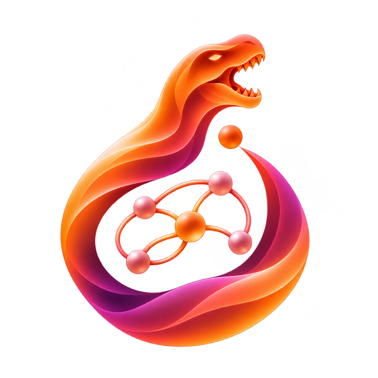

.. toctree::
   :maxdepth: 6
   :hidden:

   Overview <source/overview/index.rst>
   Reference <source/api/index.rst>
   Changelog <https://github.com/vdecaro/torchdyno/blob/main/CHANGELOG.md>

=======================
TorchDyno documentation
=======================
**TorchDyno** is a PyTorch toolkit for building models that process temporal
data, and for training them with unconventional learning approaches as well as
with backprop.

It has no model zoo. A model is a plain ``torch.nn.Sequential`` of parts from
four levels:

1. **matrices**: how a weight matrix is structured, initialised and applied;
2. **sequence maps**: how a sequence is processed, by a recurrent cell run over
   time or by random convolutions;
3. **readout**: pooling over time, then a linear map;
4. **objectives**: the task the model is trained and scored for.

Learners then fit the model, alone or chained. Echo state networks, AdaDiag,
SCN, coRNN, CfC, LRU, S4D, ROCKET and MiniRocket are all compositions of the
same parts, so a new model is usually a new composition, and a new idea is
usually one new part.

Key features include:

- structured matrices: dense, diagonal, block-diagonal, skew-symmetric
  couplings and complex ones, with ``torch.nn.init``-style initialisers;
- cells for reservoirs, ODE-based assemblies, oscillators, closed-form
  continuous-time units and linear diagonal state-space models, run step by
  step or by a parallel scan;
- ROCKET and MiniRocket random convolutions and their pooling operators;
- closed-form, online and local learners: ridge regression with leave-one-out
  selection, recursive least squares, FORCE, intrinsic plasticity and
  MiniRocket's quantile biases, next to backprop;
- sequences of different lengths in one batch, padded with NaN;
- benchmarks across seeds, and comparisons of readout-only, frozen and fully
  trained models.

.. button-ref:: source/overview/index
   :ref-type: myst
   :outline:
   :color: secondary
   :expand:
   :align: center
   :shadow:

   :octicon:`play;1em;info` Start using TorchDyno
